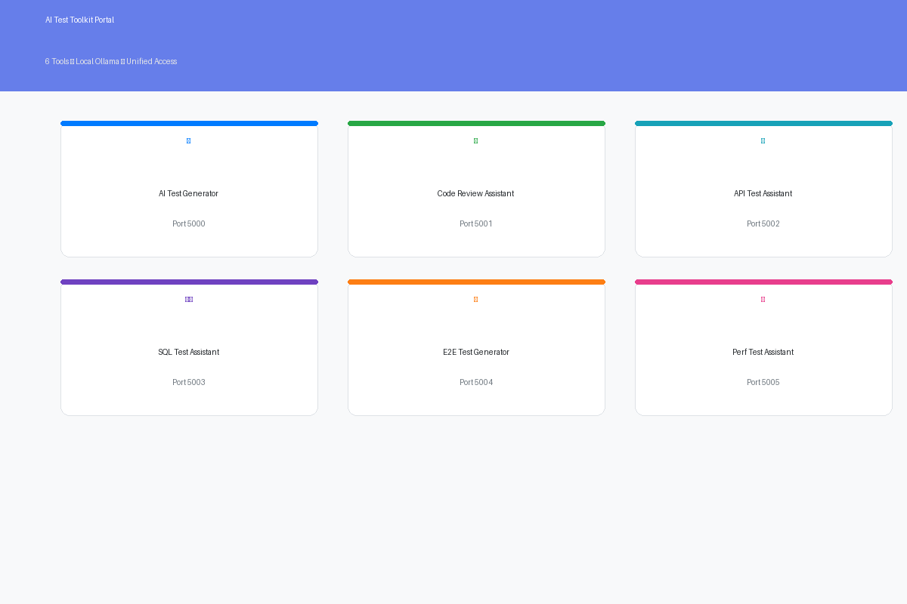
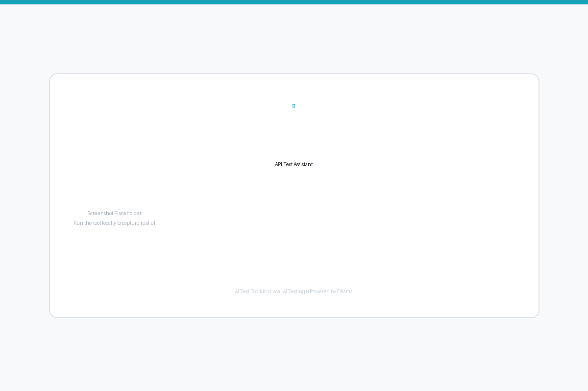
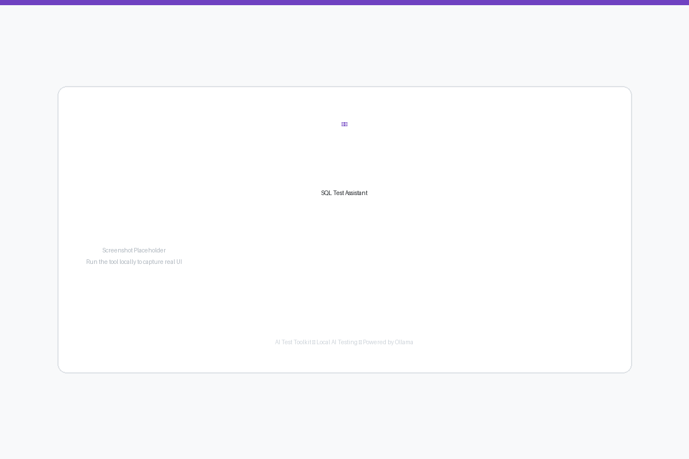
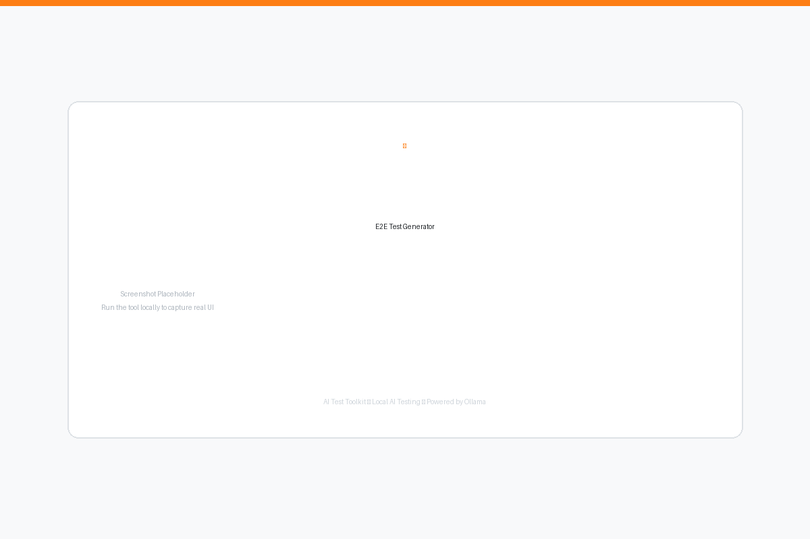
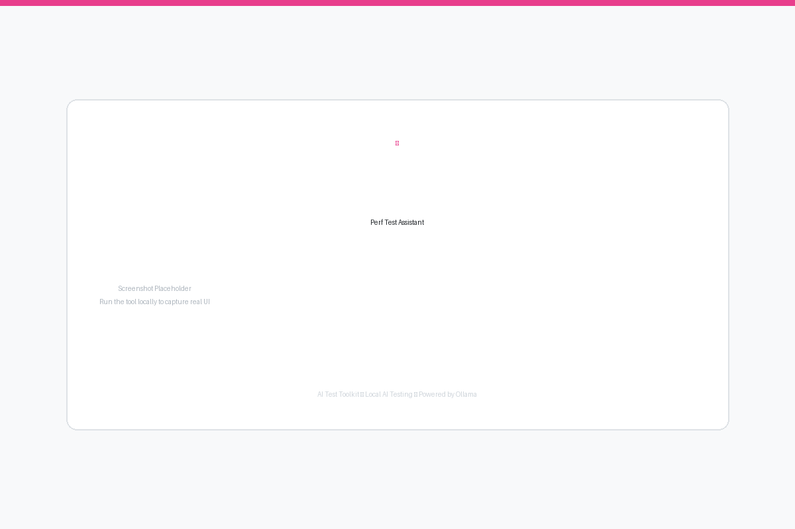

# AI Test Toolkit


> **6 Local AI-Powered Testing Tools** — One unified toolkit for requirement → review → API → SQL → E2E → Performance testing. All running offline with Ollama, zero cloud dependency.

[](LICENSE)
[](https://python.org)
[](https://ollama.ai)
[](https://github.com/astral-sh/uv)

---

## ✨ Features

| Tool | Description | Port | Key Capabilities |
|------|-------------|------|------------------|
| 🤖 **AI Test Generator** | Generate unit tests, test plans, edge cases from code/requirements | 5000 | Unit tests, test plans, boundary analysis, structured cases |
| 🔍 **Code Review Assistant** | Full code review: correctness, security, performance, style | 5001 | Security audit, style check, performance analysis |
| 🌐 **API Test Assistant** | Generate & run API test cases with AI analysis | 5002 | Test generation, execution, result analysis |
| 🗄️ **SQL Test Assistant** | Data quality checks, test generation, perf, schema review | 5003 | Quality SQL, test cases, perf tuning, schema review |
| 🎭 **E2E Test Generator** | Generate Selenium/Playwright E2E test scripts | 5004 | Selenium + Playwright, POM, CI/CD configs |
| ⚡ **Perf Test Assistant** | Performance test plans, Locust scripts, analysis templates | 5005 | Locust/JMeter, execution plans, report templates |

---

## 🏗️ Architecture

```
┌─────────────────────────────────────────────────────────────────┐
│                      AI Test Toolkit (Monorepo)                 │
├─────────────────────────────────────────────────────────────────┤
│  ┌──────────────┐  ┌──────────────┐  ┌──────────────────────┐  │
│  │  tlm-client  │  │prompt-templates│ │    toolkit-portal    │  │
│  │  (Shared)    │  │  (Shared)    │  │    (Unified Portal)  │  │
│  └──────┬───────┘  └──────┬───────┘  └──────────┬───────────┘  │
│         │                 │                     │              │
│         ▼                 ▼                     ▼              │
│  ┌─────────────────────────────────────────────────────────┐   │
│  │                    6 Independent Tools                   │   │
│  │  ai-test-generator │ code-review │ api-test │ sql-test  │   │
│  │  e2e-test-gen      │ perf-test                         │   │
│  └─────────────────────────────────────────────────────────┘   │
│                              │                                  │
│                              ▼                                  │
│                    ┌───────────────┐                           │
│                    │   Ollama      │                           │
│                    │   (qwen2.5:7b)│                           │
│                    └───────────────┘                           │
└─────────────────────────────────────────────────────────────────┘
```

**Shared Core:**
- **`tlm-client`** — Unified Ollama client with retry, timeout, streaming, async support
- **`prompt-templates`** — Curated prompt library for each testing domain

---

## 🚀 Quick Start

### Prerequisites

1. **Python 3.10+** and **uv** (recommended) or pip
2. **Ollama** running locally with a model pulled:
   ```bash
   ollama pull qwen2.5:7b
   ```

### Installation

```bash
# Clone the repo
git clone https://github.com/i-am-cie/ai-test-toolkit.git
cd ai-test-toolkit

# Install all tools with uv (recommended)
uv sync --all-extras

# Or install specific tool
uv pip install -e packages/ai-test-generator[cli]
```

### Running the Portal (Recommended)

Start the unified portal to access all tools:

```bash
uv run toolkit-portal
# Opens at http://localhost:5006
```


### Running Individual Tools

```bash
# Web UI mode
uv run ai-test-generator          # http://localhost:5000
uv run code-review-assistant      # http://localhost:5001
uv run api-test-assistant         # http://localhost:5002
uv run sql-test-assistant         # http://localhost:5003
uv run e2e-test-generator         # http://localhost:5004
uv run perf-test-assistant        # http://localhost:5005

# CLI mode
uv run ai-test-generator-cli generate --mode unit --lang python --interactive
uv run code-review-cli review --mode security --file mycode.py
```

---

## 📸 Screenshots & Demo

### Portal Dashboard


### AI Test Generator - Web UI


### Code Review Assistant - Security Review


### API Test Assistant - Generate & Run


### SQL Test Assistant - Schema Review


### E2E Test Generator - Playwright Output


### Perf Test Assistant - Locust Script


### CLI Demo


> **Note**: Screenshots and GIFs are placeholders. Run the tools locally to see them in action!

---

## 📁 Project Structure

```
ai-test-toolkit/
├── pyproject.toml              # Root workspace config (uv)
├── README.md                   # This file
├── LICENSE
├── packages/
│   ├── tlm-client/             # Shared Ollama client
│   │   ├── pyproject.toml
│   │   └── tlm_client/
│   │       ├── __init__.py
│   │       ├── client.py       # Main client logic
│   │       ├── config.py       # Configuration model
│   │       └── exceptions.py   # Custom exceptions
│   ├── prompt-templates/       # Shared prompt library
│   │   ├── pyproject.toml
│   │   └── prompt_templates/
│   │       ├── __init__.py
│   │       ├── test_generation.py
│   │       ├── code_review.py
│   │       ├── api_test.py
│   │       ├── sql_test.py
│   │       ├── e2e_test.py
│   │       └── perf_test.py
│   ├── ai-test-generator/      # Tool 1
│   ├── code-review-assistant/  # Tool 2
│   ├── api-test-assistant/     # Tool 3
│   ├── sql-test-assistant/     # Tool 4
│   ├── e2e-test-generator/     # Tool 5
│   ├── perf-test-assistant/    # Tool 6
│   └── toolkit-portal/         # Unified web portal
└── docs/                       # Screenshots, diagrams
```

---

## ⚙️ Configuration

### Environment Variables

```bash
# Ollama connection
export OLLAMA_HOST=http://localhost:11434
export OLLAMA_MODEL=qwen2.5:7b

# Tool-specific (optional)
export AI_TEST_GENERATOR_PORT=5000
export CODE_REVIEW_PORT=5001
# ... etc
```

### Custom Model

```bash
# Use different model
uv run ai-test-generator --model codellama:13b
uv run ai-test-generator-cli generate --model deepseek-coder:6.7b
```

---

## 🔧 Development

### Adding a New Tool

1. Create `packages/new-tool/` with `pyproject.toml`
2. Add dependencies: `tlm-client`, `prompt-templates`
3. Implement `app/__init__.py` with Flask web UI
4. Implement `cli.py` with Typer CLI
5. Add to root `pyproject.toml` workspace members
6. Register in `toolkit-portal/app/__init__.py`

### Running Tests

```bash
# All tests
uv run pytest

# Specific package
uv run pytest packages/ai-test-generator/tests/
```

### Code Quality

```bash
# Lint
uv run ruff check .

# Format
uv run ruff check . --fix

# Type check
uv run mypy .
```

---

## 🤝 Contributing

1. Fork the repository
2. Create a feature branch
3. Make your changes
4. Run tests and linting
5. Submit a PR

---

## 📄 License

MIT License — see [LICENSE](LICENSE) for details.

---

## 🙏 Acknowledgments

- [Ollama](https://ollama.ai) — Local LLM runtime
- [uv](https://github.com/astral-sh/uv) — Fast Python package manager
- [Flask](https://flask.palletsprojects.com) — Web framework
- [Typer](https://typer.tiangolo.com) — CLI framework
- [Rich](https://rich.readthedocs.io) — Beautiful terminal output
- [qwen2.5](https://github.com/QwenLM/Qwen2.5) — Default model

---

## 📞 Support

- **Issues**: [GitHub Issues](https://github.com/i-am-cie/ai-test-toolkit/issues)
- **Discussions**: [GitHub Discussions](https://github.com/i-am-cie/ai-test-toolkit/discussions)
- **Email**: i-am-cie@users.noreply.github.com

---

<p align="center">Made with ❤️ by <a href="https://github.com/i-am-cie">i-am-cie</a></p>
